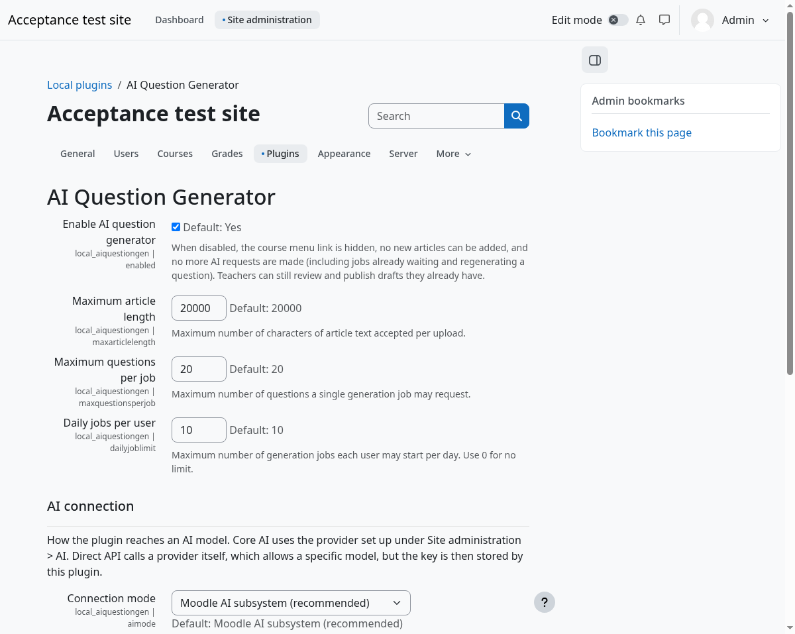

# AI Question Generator: administrator guide

Plugin: `local_aiquestiongen`. Version 0.8.2. Moodle 5.0 or later. Tested on 5.0, 5.1, 5.2 and 5.3 (see "What has and has not been tested").

## What it does

A teacher adds an article. A background task asks an AI model to draft English-as-a-foreign-language questions. The teacher reviews each draft. Only approved questions are added to the question bank, and optionally to a quiz.

## Requirements

- Moodle 5.0 to 5.3, PHP as required by your Moodle version.
- **Cron must run.** Generation is an ad hoc task. If cron is not running, jobs stay on "Waiting to start".
- An AI connection (see below).
- Optional, for PDF uploads: `poppler-utils` (provides `pdftotext`).

## Install

1. Copy the `aiquestiongen` folder to:
   - Moodle 5.0: `local/aiquestiongen`
   - Moodle 5.1 and later: `public/local/aiquestiongen`
2. Visit **Site administration > Notifications**, or run `php admin/cli/upgrade.php`.
3. Open **Site administration > Plugins > Local plugins > AI Question Generator**.
4. Choose a connection mode (below) and save.

### Installing from the ZIP file

Instead of copying the folder, you can upload `local_aiquestiongen_vX.Y.Z.zip` from the
[releases page](https://github.com/billsensei/moodle-local_aiquestiongen/releases) at **Site administration > Plugins >
Install plugins**, then confirm and upgrade. Upload the file exactly as downloaded.

If Moodle says **"The file provided is not a valid plugin ZIP package"**, the ZIP does not have exactly one folder at
its top level. The usual causes are:

- The ZIP was made again by hand. Compressing a folder in macOS Finder adds a second top-level entry, `__MACOSX`,
  which is enough to fail. Safari can also unpack a download for you ("Open safe files after downloading"); turn that
  off and use the file as downloaded.
- The files of the plugin were zipped without their folder, so `version.php` sits at the top level.
- The file is not a ZIP (a saved web page, or a `.tar.gz` renamed to `.zip`).

To check a ZIP, run `unzip -l file.zip | head`. Every path should start with the same single folder
(`aiquestiongen/`; GitHub's own "Source code (zip)" uses `moodle-local_aiquestiongen-X.Y.Z/`, which also works).
To make a good ZIP yourself, run `zip -r -X aiquestiongen.zip aiquestiongen` in Terminal.

## Permissions

| Capability | Default roles | Allows |
|---|---|---|
| `local/aiquestiongen:use` | Teacher, Manager | Add articles, generate, review |
| `local/aiquestiongen:publish` | Teacher, Manager | Publish approved questions to the question bank |

Both are checked in the course context. Teachers see only articles and drafts they created themselves; other teachers' work is refused, including for managers. Students have no access.

## Settings

The screenshots in these guides were taken on a test site, so the site name and sample data are not real.

| Setting | Default | Notes |
|---|---|---|
| Enable AI question generator | On | Off hides the course menu link, blocks new articles, and stops all AI requests, including jobs already waiting and Regenerate. Teachers can still review and publish drafts they already have. |
| Maximum article length | 20000 characters | Longer articles are refused at upload. Longer articles cost more tokens. |
| Maximum questions per job | 20 | Total across all question types. |
| Daily jobs per user | 10 | 0 means no limit. |
| Daily regenerations per user | 30 | Across all drafts, per user, per day (in the user's timezone). Every Regenerate request that reaches the AI counts, even if it produces nothing usable, because it costs the same. Each draft can also be regenerated at most 5 times. 0 means no daily limit. Teachers can still edit drafts by hand. |
| Connection mode | Moodle AI subsystem | See below. |
| Path to pdftotext | empty | e.g. `/usr/bin/pdftotext`. Empty disables PDF upload. |

## Connection mode A: Moodle AI subsystem (recommended)

The plugin calls Moodle's own AI "generate text" action, so Moodle's provider configuration, logging, policy acceptance and rate limits apply.

1. Go to **Site administration > AI** and set up an AI provider (for example OpenAI or Azure OpenAI, whichever your Moodle version offers).
2. Make sure the provider's **Generate text** action is enabled.
3. Leave this plugin on "Moodle AI subsystem".

Note: the model, token limits and output format are controlled by the core provider, not by this plugin. If a provider returns replies that are cut off, raise its limits there.

## Connection mode B: Direct API

Choose this if you need a specific model that core AI does not offer.

| Setting | Notes |
|---|---|
| Direct API type | Anthropic Claude (Messages API), or OpenAI-compatible (chat completions). |
| Endpoint base URL | Claude: leave empty for `https://api.anthropic.com`. OpenAI-compatible: the base URL up to and including `/v1`, e.g. `https://api.openai.com/v1`. Must start with `https://`; `http://` is accepted only for `localhost`, for a model on the same server. |
| API key | Stored encrypted (Moodle's encryption, sodium). The settings page never shows the saved key; enter a new one to change it. The encryption key is a file in the `secret/key` folder of the site data directory, so **back that folder up with the database**: after a restore without it, the saved key cannot be read and must be entered again. Use a key with a spending limit. |
| Model | Sent with each request. Default `claude-sonnet-5-5`. |
| Maximum reply tokens | Default 8000. Raise if long jobs come back cut off. |
| Request timeout | Default 120 seconds per reply. |

Direct mode bypasses Moodle's AI policy and logging. Requests use Moodle's HTTP client, so **Site administration > General > Security > HTTP security** (blocked hosts and allowed ports) applies. If you see "The AI service could not be reached", check those lists first.

## Privacy and data

- The article text and generation instructions are sent to the AI provider you configured. Tell staff not to upload material they have no right to share, or that contains personal data. The teacher page shows a notice.
- Stored in Moodle: the article text, the uploaded file, jobs and drafts. All are included in Moodle's privacy export and deletion, and the privacy provider lists the external AI provider.
- Deleting a user removes their articles, jobs and drafts. Questions already published to the question bank belong to the question bank and are not removed by this plugin.

## Troubleshooting

| What the teacher sees | Likely cause |
|---|---|
| Job stays on "Waiting to start" | Cron is not running, or the site is in maintenance mode. Run `php admin/cli/adhoc_task.php --execute`. |
| "The AI provider could not generate text" | Core AI provider not set up or its Generate text action is off, or a provider error. See Site administration > Reports > Logs and the AI reports. |
| "Direct API mode is selected but not fully set up" | API key or model is empty, or the endpoint is missing (OpenAI-compatible) or does not start with `https://`. |
| "The saved API key could not be read" | The site was moved or restored without its `secret/key` folder. Enter the API key again. |
| "You have reached the daily limit of N regenerations" | The teacher used their Daily regenerations allowance. It resets at their midnight. Raise the setting if it is too tight. |
| "The AI service refused the request (HTTP 401/403)" | Wrong key, or the key may not use that model. |
| "too many requests or the quota is used up" | Provider rate limit (HTTP 429). Try later. |
| "The AI service could not be reached" | Endpoint wrong, no outbound network, or HTTP security settings block the host. |
| "The AI reply could not be read as questions" | The model returned something that is not the requested format, twice. Try again or try a stronger model. |
| Some questions marked "Needs checking" | The AI's draft broke a rule (for example no single correct answer). The teacher must edit it before approving. This is normal and not an error. |
| "PDF extraction is not available" | `pdftotext` path not set. |
| "This course has no question bank where you can add questions" | Moodle 5.x keeps questions in question bank modules. Create one in the course. |

## What has and has not been tested

Tested, on each of Moodle 5.0.11, 5.1.8, 5.2.4 and 5.3: install and upgrade, PHPUnit (162 tests) and Behat (13 browser scenarios), all passing, with a stubbed AI. The tests cover privacy, language packs, permissions, the key encryption, publishing to the question bank and quizzes, and the review page in a browser. Coding standards were checked on 5.3.

Not yet tested:

- A real AI provider, through either mode. Do a trial run with a short article before releasing it to teachers.
- Later point releases of each version, and databases other than MariaDB (all testing used MariaDB 11 and PHP 8.4).
- The essay and fill-in-the-blank edit screens, the quiz option and the settings page in a browser.
- Keyboard-only and screen reader use.
- The Japanese language pack has not been read by a native speaker.

## Uninstall

**Site administration > Plugins > Plugins overview**, find AI Question Generator and choose Uninstall. This drops the three plugin tables. Published questions and quizzes are left alone.
