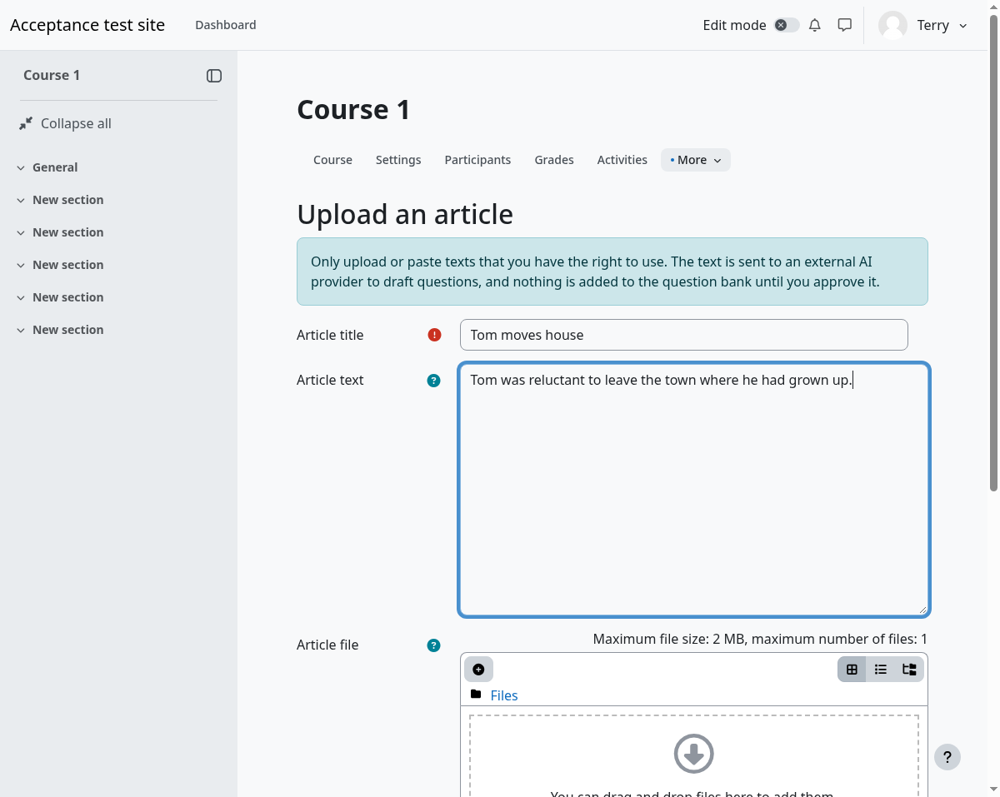
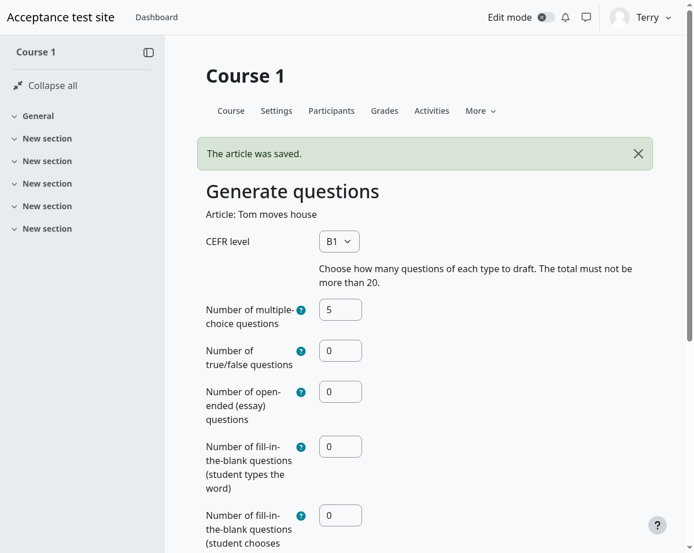
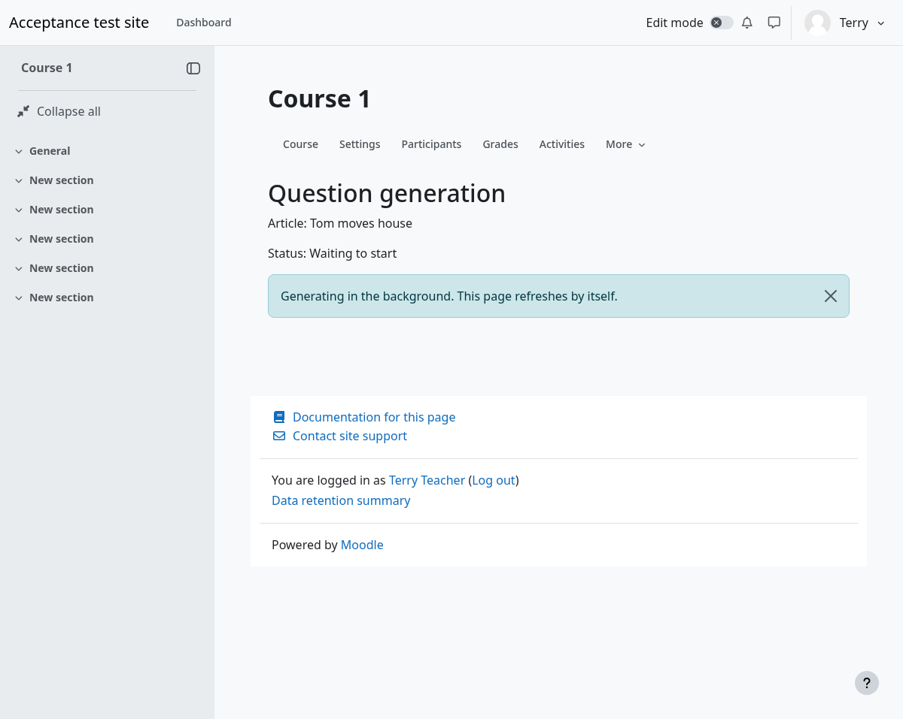
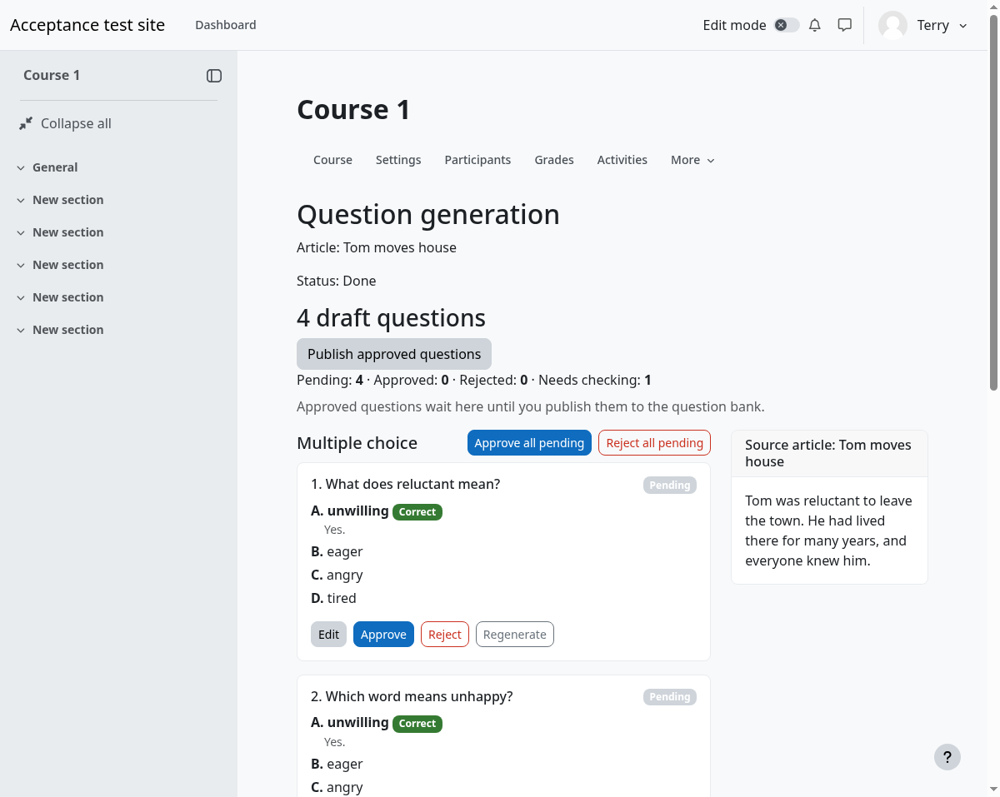
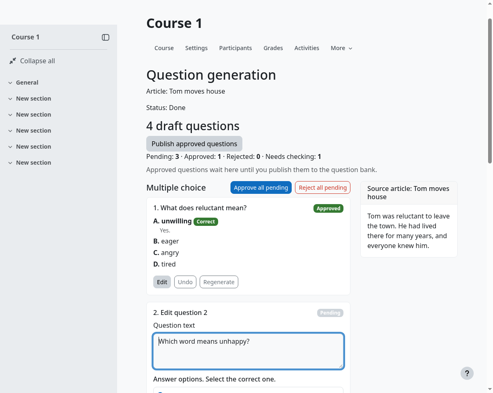
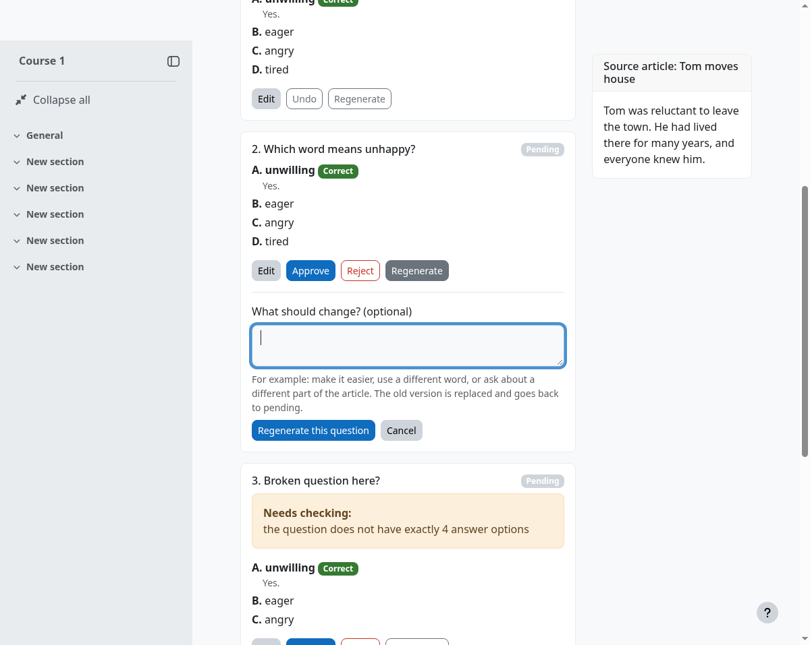
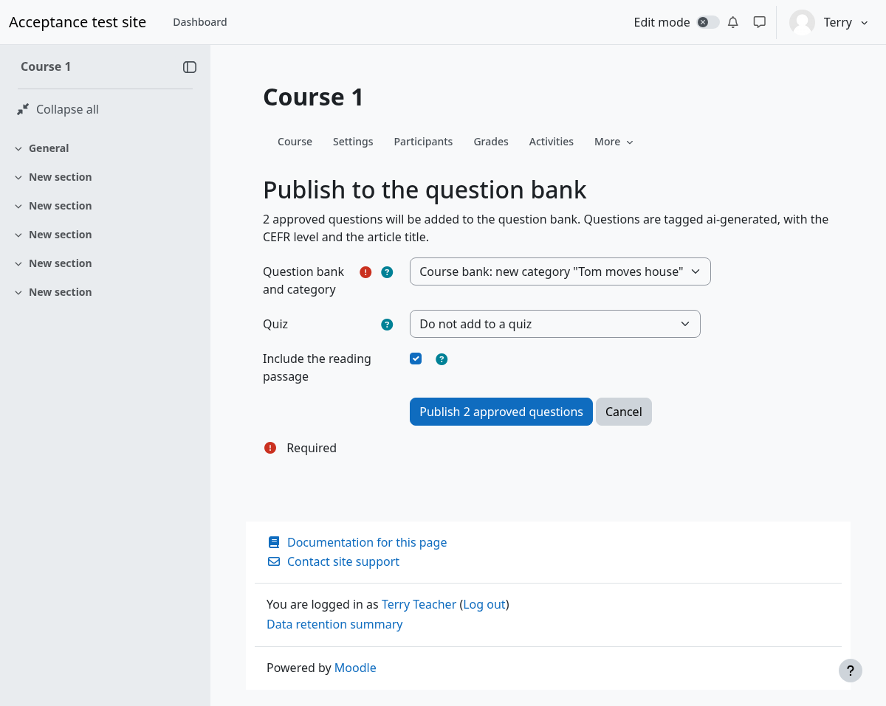
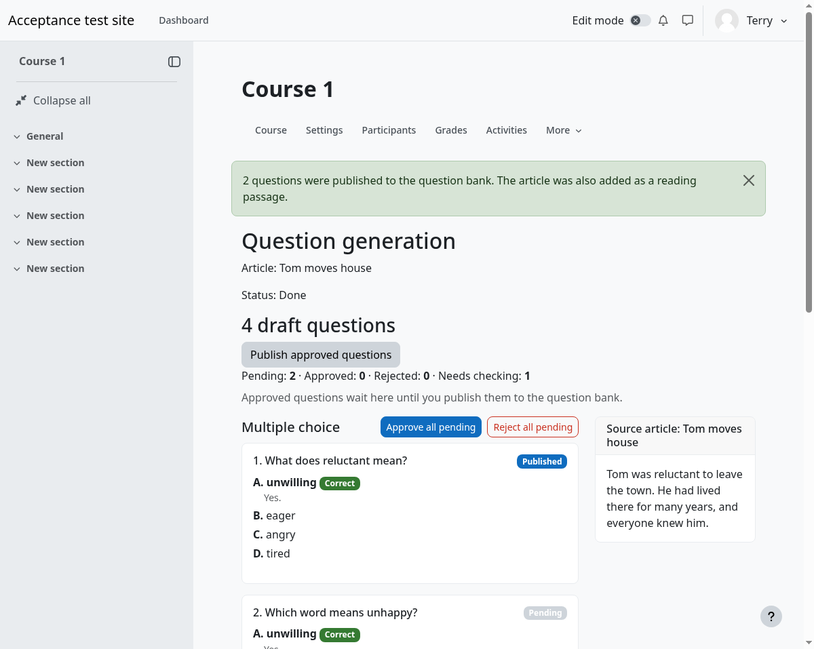

# AI Question Generator: teacher quick-start

You give it an article. It drafts questions. **You decide what goes into the question bank.** Nothing is added until you approve it and press Publish.

The screenshots were taken on a test site with sample data.

## 1. Add an article

1. Open your course. In the **More** menu choose **AI question generator**.
2. On the **Upload an article** page, give the article a title.
3. Either paste the text, or upload a `.txt`, `.docx`, `.pdf` or `.html` file. Use one or the other, not both. (PDF works only if your administrator has set it up.)
4. Press **Save article**.

Only use texts you have the right to use. The text is sent to an external AI service.

## 2. Choose what to generate

| Choice | What it means |
|---|---|
| CEFR level | A1 to C2. Controls the difficulty of the language. |
| Number of multiple-choice questions | Vocabulary and grammar, four options, one correct. |
| Number of true/false questions | Reading comprehension statements. |
| Number of open-ended (essay) questions | Comes with a model answer and a marking guide for you. |
| Number of fill-in-the-blank, student types the word | One blank per sentence. Other correct words can be accepted. |
| Number of fill-in-the-blank, student chooses from a list | A drop-down of four words. Suits lower levels. |
| Target vocabulary or grammar | Optional. Comma-separated. Vocabulary words must appear in the article. |
| Language of answer feedback | English or Japanese. |

The total has a limit set by your administrator, and there is a daily limit on jobs. Press **Generate draft questions**.

## 3. Wait

The page says it is generating in the background and refreshes by itself. It can take a minute or more. You can leave and come back from the AI question generator page.

## 4. Review

Drafts are grouped by question type. Each draft has:

- **Approve**, **Reject**, **Undo**
- **Edit**: change the question, answers, feedback or marking guide, then **Save changes**
- **Regenerate**: ask for a different question, optionally saying what to change ("easier", "use another word"). Each question can be regenerated up to 5 times, and there is a daily limit on regenerations across all your questions (your administrator sets it). Every attempt counts, even if the AI could not write a usable question.
- **Approve all pending** / **Reject all pending** for a whole group. Rejecting all asks you to confirm.

A draft marked **Needs checking** broke a rule (for example, no single correct answer). It says what is wrong. Edit it, then approve. Approve all skips these.

Check every answer yourself. The AI can be wrong, even when a draft looks valid. The source article is shown on the page so you can compare.

The page works with a keyboard, and changes are announced to screen readers, but this has not been tested with real assistive technology yet.

## 5. Publish

1. Press **Publish approved questions**.
2. Choose the **question bank and category**, or have a new category named after the article created.
3. Optional: **Include the reading passage**. This adds the article to the bank as a description item tagged `reading-comprehension`.
4. Optional: put the questions in a **quiz**, new or existing. A new quiz is created hidden, with all questions on one page, so you can check it first.
5. Press **Publish**.

Questions are tagged `ai-generated`, the CEFR level (for example `cefr-b1`), and the article title. Find them in the question bank by filtering on those tags or on the category.

Published questions can no longer be changed from this plugin; edit them in the question bank. If some fail to publish they stay approved, and you can try again.

## If something goes wrong

| Message | What to do |
|---|---|
| The AI did not return any usable questions / could not be read | Press Try again. If it keeps happening, ask your administrator. |
| Daily limit reached (jobs or regenerations) | Try tomorrow. For a single question, edit it by hand instead. |
| No question bank in this course | Add a question bank to the course, then publish. |
| Any "AI service" or "provider" error | Tell your administrator. It is a site setting. |
| The generator is disabled | Your administrator turned it off. Drafts you already made can still be reviewed and published. |
